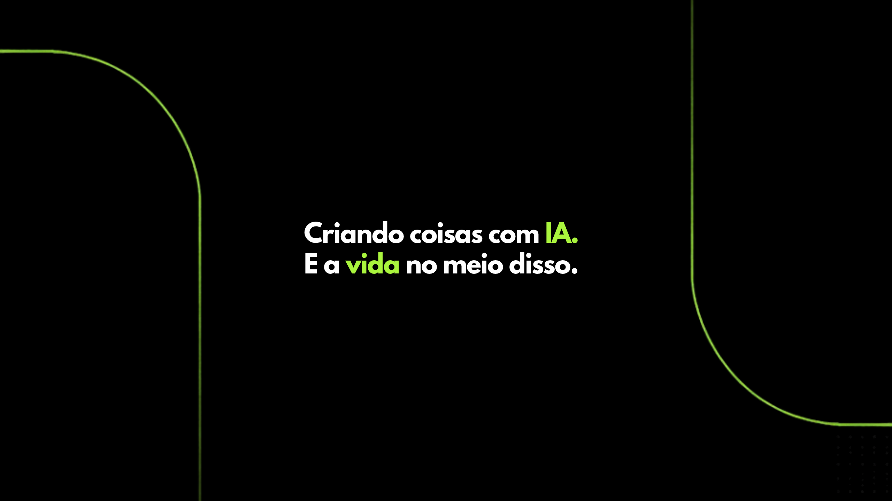

### Construo software com IA sem ser programador.

Trabalho como barbeiro há mais de dez anos e, desde o início de 2025, construo software com IA. A IA escreve o código; eu decido o produto, a arquitetura e o que vai para produção.

Parte desse caminho eu mostro no [YouTube](https://www.youtube.com/@carlosimlau).

 

## O que já construí

| | O quê | Estado |
|---|---|---|
| **[Tapinfy](https://github.com/carlosimlau/tapinfy-case)** | Agendamento, página e gestão para barbearias. | 🟢 Em produção, com cliente pagante |
| **[Falatuga](https://github.com/carlosimlau/falatuga-case)** | Adapta currículos do português do Brasil para o de Portugal, usando a AMALIA. | 🟢 No ar, gratuito |
| **[Taí e Rob](https://github.com/carlosimlau/taierob-case)** | Site de casamento com lista de presentes, RSVP e pagamentos. | 🟢 No ar |
| **[Escola Nova Era Tech](https://github.com/carlosimlau/plataforma-educacional-case)** | V1 do portal do aluno gamificado. | ⚪ Entregue, mantido pela escola |
| **[Sourmize](https://github.com/carlosimlau/sourmize-case)** | Tracking de links com UTMs geradas por IA. | ⚪ Case, fora do ar |

 

## Ferramentas que uso todo dia

 

## Onde me encontrar

Também construo projetos para outras pessoas. Se você tem um, me escreve.

